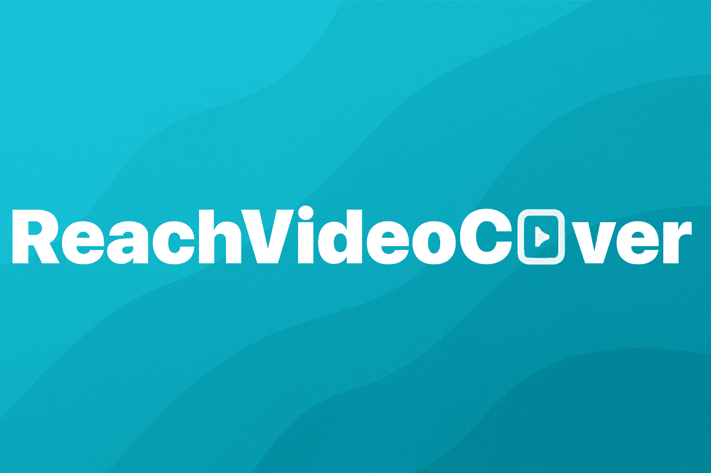
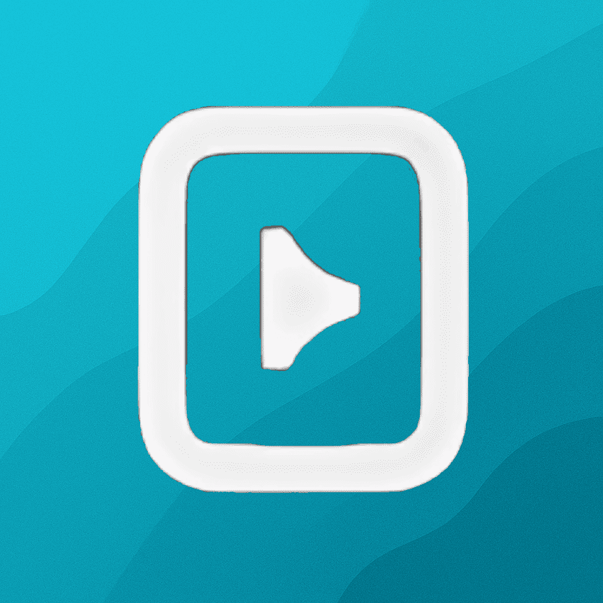
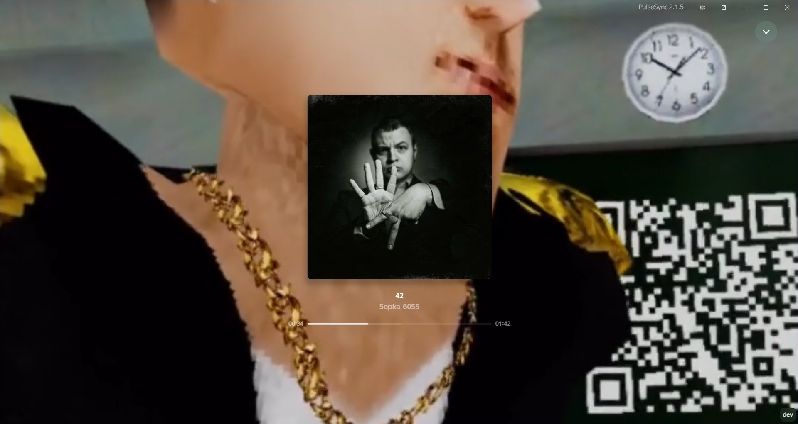
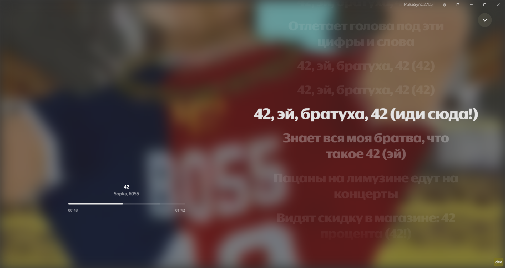

  

<h1 align="center">
  &nbsp;ReachVideoCover
</h1>

<b>ReachVideoCover</b> — аддон на Яндекс Музыку, добавляющий на фон полноэкранного режима видеообложку (если она доступна) как на телефонах.

 

<h2 align="center">Демонстрация аддона</h2>

