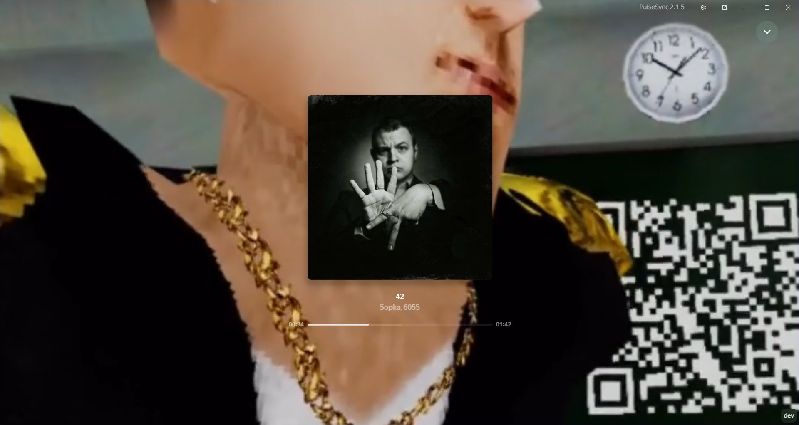
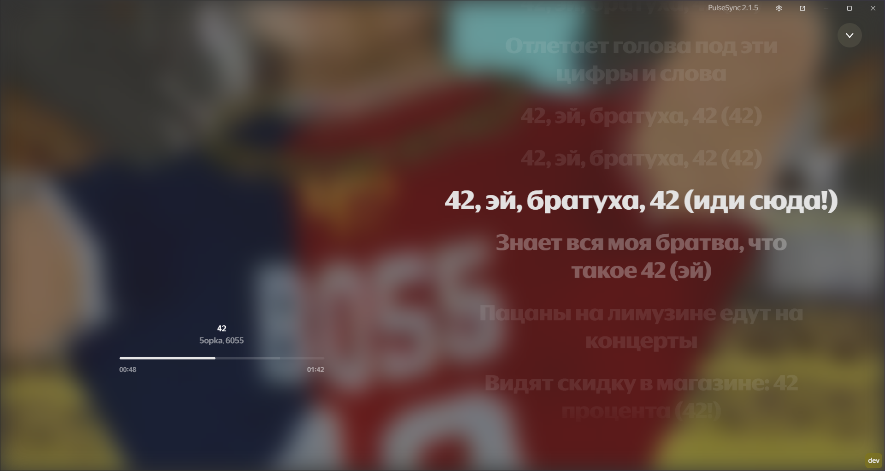

  

<h1 align="center">
  ReachVideoCover
</h1>

<b>ReachVideoCover</b> — аддон, добавляющий на фон полноэкранного режима видеообложку (если она доступна) как на телефонах.

 
<h2 align="center">Демонстрация аддона</h2>

